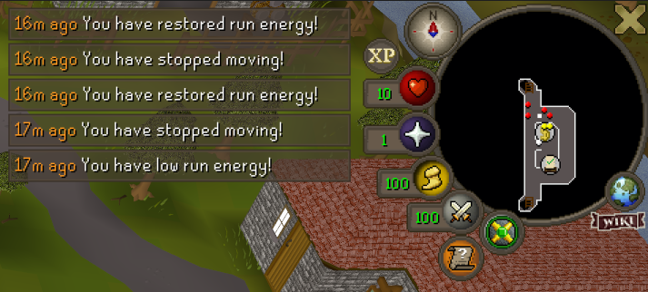

# Notification Feed

Shows a live feed of RuneLite notifications inside the game window. Gone are the days where you miss a notification and wonder what it was!

Any notification that RuneLite sends shows up in the feed, including ones from core plugins (Idle Notifier, Timers, etc.), and hub plugins. This includes notifications that were fired but not shown (e.g. foreground-disabled notifications).

This plugin is similar to another active plugin, [Notification Panel](https://runelite.net/plugin-hub/show/notification-panel), which works very well. I created this plugin to cater to my preferred "feed" style using the "{time} {message}" format to more closely match the RuneScape UX.

## Usage

- Move the feed by holding <kbd>Alt</kbd> and dragging it. While <kbd>Alt</kbd> is held, the feed stays visible even when it has no notifications.
- Resize the feed's width by holding <kbd>Alt</kbd> and dragging the edges of the box.
- Clear the feed with <kbd>Shift</kbd> + right-click → *Clear*.

## Settings

**Feed**

| Setting | Description |
| --- | --- |
| Max notifications | How many notifications are shown at once |
| Display duration | Seconds each notification stays (0 = until pushed out or cleared) |
| Fade out | Fade notifications out during their last second |
| Newest on top | Put new notifications at the top instead of the bottom |
| Collapse duplicates | Merge repeats of the same notification into one entry with a count |
| Duplicate time limit | Minutes after which a repeat starts a new entry instead of collapsing (0 = no limit) |
| Show when empty | Keep a placeholder visible when there are no notifications |
| Ignored notifications | Wildcard patterns, one per line, e.g. `*is now idle*` |

**Appearance**

| Setting | Description |
| --- | --- |
| Style | Separate boxes per notification, or one panel |
| Timestamp | None, 24-hour, 12-hour (with or without seconds), relative ("2m ago"), or custom |
| Custom timestamp | Format used by the Custom timestamp option, e.g. `HH:mm:ss` or `HH:mm ({relative})`. See below |
| Wrap long text | Wrap long notifications, or cut them off with "..." |
| Font | Notification font |
| Text / Timestamp / Background color | Colors |

### Custom timestamp format

The custom format uses Java's [date/time pattern letters](https://docs.oracle.com/en/java/javase/11/docs/api/java.base/java/time/format/DateTimeFormatter.html#patterns). Letters are case-sensitive: `mm` is minutes, `MM` is the month.

| Pattern | Meaning | Example |
| --- | --- | --- |
| `HH` / `H` | Hour, 00-23 / 0-23 | `13` |
| `hh` / `h` | Hour, 01-12 / 1-12 | `1` |
| `mm` | Minute | `05` |
| `ss` | Second | `09` |
| `a` | AM/PM | `PM` |
| `dd` / `MM` / `yyyy` | Day / month / year | `16` / `11` / `2026` |
| `EEE` | Weekday | `Mon` |
| `{relative}` | Time since the notification | `2m ago` |
| `'text'` | Literal text | `'at'` → `at` |

For example, `h:mm a ({relative})` shows `[1:05 PM (2m ago)]`. If the pattern is invalid the feed shows `[invalid format]`; leave it blank to hide timestamps.
